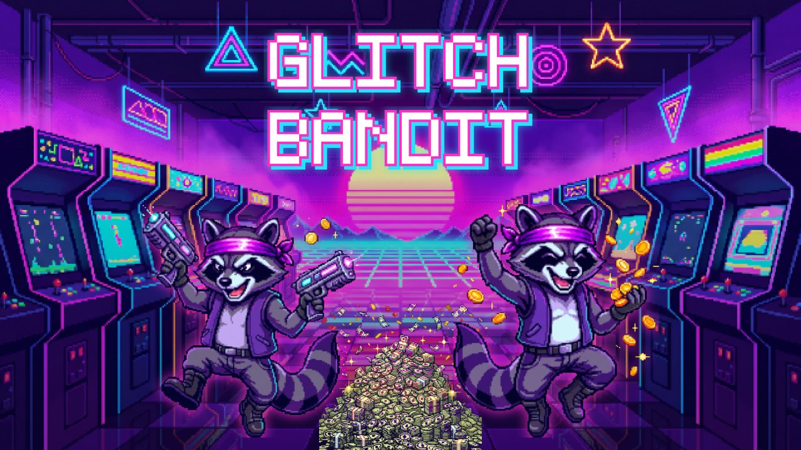

# LiboStudio: Real-Money Slot Games for Stake Engine

I'm Libardo Palacios, a game developer from Medellín, Colombia. LiboStudio is my solo studio. I build casino games for Stake Engine, from the game math to gameplay, animation, audio, testing and release.

I build by directing AI coding agents (Claude Code): I write the specifications, review every change, and verify results through playtesting and automated checks.

LinkedIn: https://www.linkedin.com/in/libardopalacios

> The full game source is private (these are real-money games). This repository shows the games and some of the tools and code I wrote for them.

---

## Glitch Bandit

A cyberpunk cluster slot with raccoon bandits in a neon arcade.

- **Stake review:** rated **6.0 / 9** by 3 independent Stake reviewers, meeting the publication threshold. Final compliance review in progress (November 2026).
- 3 bet modes, cascading wins, free spins and multiplier orbs.
- Retro neon arcade look with synthesized music and sound effects.

## Hexbound

A gothic witch slot set in a potion tower.

- 4 game modes (base, bonus, brew, Full Moon) and special features like Hex Strike.
- Win tiers with their own celebrations, a witch character with 5 poses, painted fire effects.
- A gothic HUD drawn in code: stone medallions with silver rims (see `code/ui_skin.ts`).
- An original drum-driven soundtrack and 52 sound effects, synthesized in Python.

---

## Tech

**TypeScript · Svelte 5 · PixiJS 8 (WebGL) · Python · Stake Math SDK and Web SDK · Playwright**

## Code samples

| File | What it does |
|---|---|
| [`code/mock_rgs.py`](code/mock_rgs.py) | A local fake of Stake's game server (RGS). It serves the game's math files, runs a wallet, and lets me replay any specific game round to reproduce a bug. Handles multi-GB result files by streaming them from disk. |
| [`code/check_fe.py`](code/check_fe.py) | 12 automated checks that run before every release. They confirm the front end and the math agree (bet modes, symbols, every game event has a handler) and catch regressions against Stake's approval guidelines. |
| [`code/ui_skin.ts`](code/ui_skin.ts) | The HUD button skins drawn with vector graphics, no image files: a neon glass style for Glitch Bandit and a gothic stone style for Hexbound, chosen per game. |
| [`code/NeonButtonFace.svelte`](code/NeonButtonFace.svelte) | The animated button component: hover, press, active pulse and the rotating spin button. |
| [`code/make_hexbound_sounds.py`](code/make_hexbound_sounds.py) | Generates Hexbound's whole soundtrack and sound effects from code (drums, brass, choir, effects) and packs them into an audio sprite. |

## How I test

1. **Play locally exactly like production** with the mock server, including forcing a specific round (for example the max win) to check rare events.
2. **Automated checks** (`check_fe.py`) before every build.
3. **Browser automation** with Playwright to screenshot each feature and catch visual bugs.
4. **Stake's 51-point approval checklist** as acceptance criteria.

Bugs I found and fixed this way include a missing font in the HUD falling back to a serif font, audio layers of different lengths crashing the sound mixer, and a sprite sheet cut at the wrong row.
