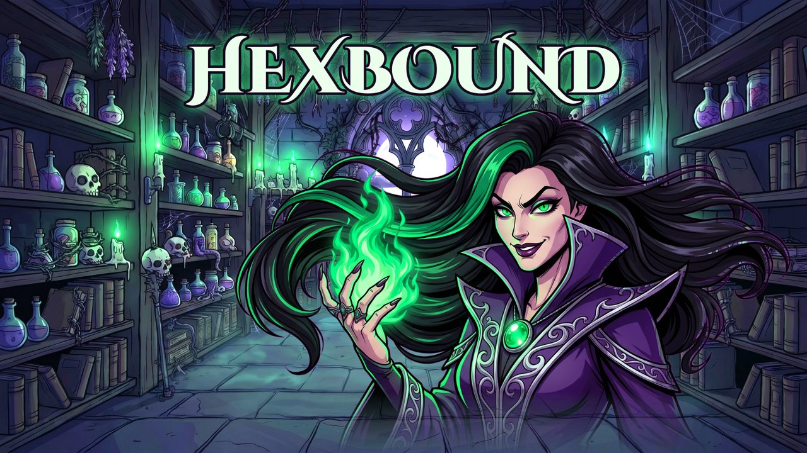
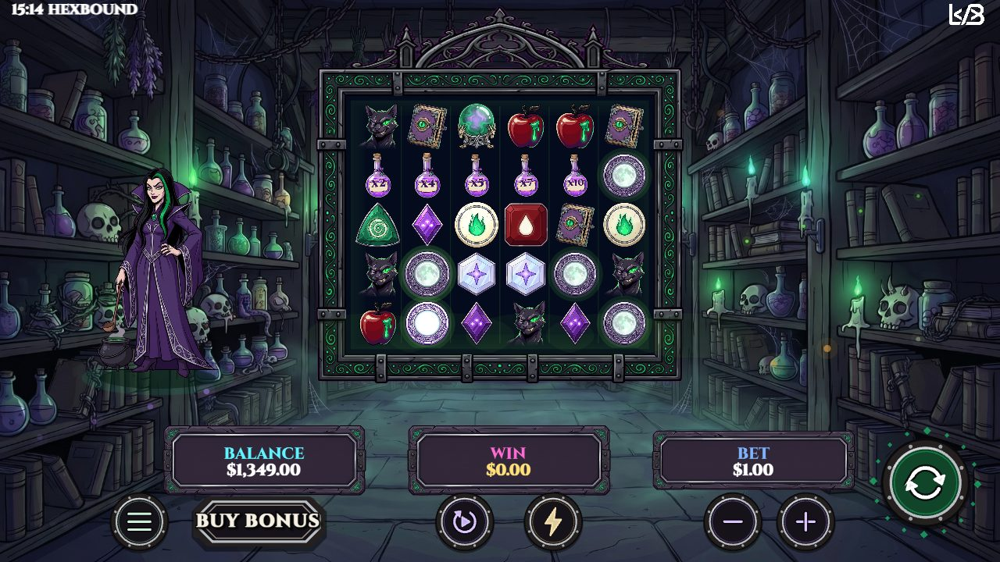
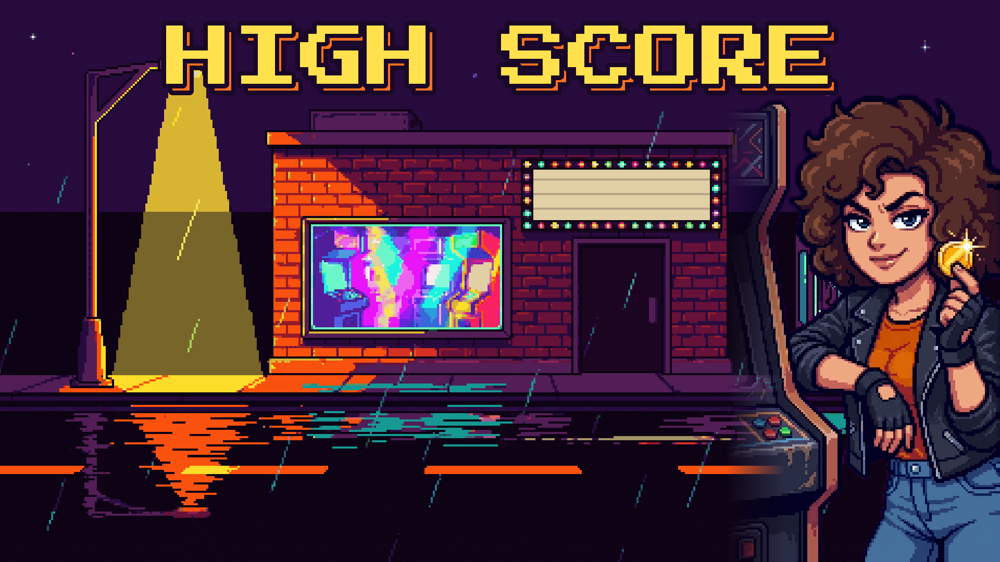

# LiboStudio: Real-Money Slot Games for Stake Engine

I'm Libardo Palacios, a game developer from Medellín, Colombia. LiboStudio is my solo studio. I build casino games for Stake Engine, from the game math to gameplay, animation, audio, testing and release. I also design and build websites (see the web section below).

I build by directing AI coding agents (Claude Code): I write the specifications, review every change, and verify results through playtesting and automated checks.

LinkedIn: https://www.linkedin.com/in/libardopalacios

> The full game source is private (these are real-money games). This repository shows the games and some of the tools and code I wrote for them.

---

## Glitch Bandit

A cyberpunk cluster slot with raccoon bandits in a neon arcade.

- **Stake review:** rated **6.0 / 9** by 3 independent Stake reviewers, meeting the publication threshold. Final compliance review in progress (November 2026).
- 3 bet modes, cascading wins, free spins and multiplier orbs.
- Retro neon arcade look with synthesized music and sound effects.

## Hexbound

A gothic witch slot set in a potion tower.

- 4 game modes (base, bonus, brew, Full Moon) and special features like Hex Strike.
- Win tiers with their own celebrations, a witch character with 5 poses, painted fire effects.
- A gothic HUD drawn in code: stone medallions with silver rims (see `code/ui_skin.ts`).
- An original drum-driven soundtrack and 52 sound effects, synthesized in Python.

## HIGH SCORE

An 80s arcade slot in true pixel art, with a rival to beat: Roxy.

- **Stake review:** rated **6.0 / 9** by Stake reviewers (November 2026), meeting the publication threshold. Going live now, with animation upgrades planned for a re-rating.
- A 15-line game with expanding sticky wilds, free spins and a Hold & Win coin bonus. Beat Roxy's score inside the coin bonus and every coin, jackpot and the grand prize doubles.
- 3 bet modes, 96.50% RTP, max win 10,000x.
- The whole screen is styled as an arcade cabinet: pixel control panel, round arcade spin button with chasing marquee bulbs, CRT scanlines, rain and neon.
- Pixel animation generated in code (Python, Pillow, NumPy): 50 symbol frames that play on land, at idle and on wins, plus Roxy's blinks, winks, hops and a gum bubble that grows and pops.
- Respects reduced motion and turbo mode.

---

## Web: LIBO STUDIOS website

Live: https://libostudios.space/
Code: https://github.com/palaciosrestrepo35/libo-studios

Besides games, I build websites. LIBO STUDIOS is my web design and development studio in Medellín, and this is its bilingual site (Spanish and English).

- **No framework.** Plain HTML, CSS and JavaScript, served by Vercel as is. Fast, with nothing to install.
- **My own small build tool** (`tools/build.mjs`): each page is written once with a JSON header (title, description, breadcrumb, Google structured data). The tool wraps it in the shared layout and writes the final pages and the sitemap.
- **Automatic quality checks** (`tools/check.mjs`) on every page before deploy: title and description length, exactly one main heading, no broken links, valid Google data, minimum word count on service pages, and plain language with no technical jargon for clients.
- **Motion and WebGL:** an animated WebGL2 shader background in every page header, plus scroll animations and interactive components ported from GSAP and React Bits to plain JS and CSS. Visitors who ask for reduced motion get a static, complete page.
- **SEO:** canonical URLs, hreflang between Spanish and English, Open Graph images, FAQ data for Google and instant indexing through IndexNow.

---

## Tech

**TypeScript · Svelte 5 · PixiJS 8 (WebGL) · Python · Stake Math SDK and Web SDK · Playwright**

**Web:** HTML · CSS · JavaScript · WebGL2 · Node.js build tools · Vercel

## Code samples

| File | What it does |
|---|---|
| [`code/mock_rgs.py`](code/mock_rgs.py) | A local fake of Stake's game server (RGS). It serves the game's math files, runs a wallet, and lets me replay any specific game round to reproduce a bug. Handles multi-GB result files by streaming them from disk. |
| [`code/check_fe.py`](code/check_fe.py) | 12 automated checks that run before every release. They confirm the front end and the math agree (bet modes, symbols, every game event has a handler) and catch regressions against Stake's approval guidelines. |
| [`code/ui_skin.ts`](code/ui_skin.ts) | The HUD button skins drawn with vector graphics, no image files: a neon glass style for Glitch Bandit and a gothic stone style for Hexbound, chosen per game. |
| [`code/NeonButtonFace.svelte`](code/NeonButtonFace.svelte) | The animated button component: hover, press, active pulse and the rotating spin button. |
| [`code/make_hexbound_sounds.py`](code/make_hexbound_sounds.py) | Generates Hexbound's whole soundtrack and sound effects from code (drums, brass, choir, effects) and packs them into an audio sprite. |

## How I test

1. **Play locally exactly like production** with the mock server, including forcing a specific round (for example the max win) to check rare events.
2. **Automated checks** (`check_fe.py`) before every build.
3. **Browser automation** with Playwright to screenshot each feature and catch visual bugs.
4. **Stake's 51-point approval checklist** as acceptance criteria.

Bugs I found and fixed this way include a missing font in the HUD falling back to a serif font, audio layers of different lengths crashing the sound mixer, and a sprite sheet cut at the wrong row.
